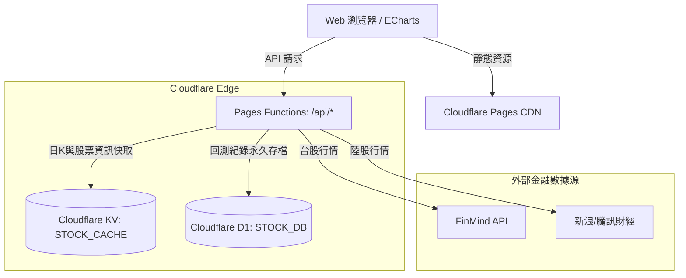

# Stock ATR & Grid Trading Backtest Viewer / 股票平均真實波幅與蛛網量化回測系統

## 簡介 / Introduction

本專案是一個專為股票與 ETF 蛛網／網格交易設計的分析、參數尋優與量化回測工具，目前支援 **台股** 與 **陸股 (A股)**。
系統基於 **Cloudflare 全端無伺服器架構（Pages + Functions + D1 + KV）** 構建，具備全球高可用、超低延遲、零冷啟動與極低維運成本。

This project is an analysis, parameter optimization, and backtest tool designed for stock/ETF grid trading, currently supporting **Taiwan Stocks** and **A-Shares**.
Built on **Cloudflare Fullstack Serverless Architecture (Pages + Functions + D1 + KV)**, it offers global high availability, low latency, near-zero cold starts, and minimal maintenance costs.

---

## 核心特性 / Features

* **多市場行情即時支援 / Multi-market Data Support**:
  * 自動識別並載入 台股（FinMind API，單位為「張」）及 陸股（新浪／騰訊財經，單位為「手」）歷史日K與股票名稱。
* **真實波幅分析 / ATR Volatility Analysis**:
  * 計算並視覺化 ATR 與真實波幅比率（True Range Ratio），輔助擬定合理網格跳動間距。
* **智能參數尋優（效益推薦） / Parameter Optimization**:
  * **一目了然獲取最佳效益**：自動掃描 1% ~ 10% 各檔跳動間距，直觀找出最高報酬率、最佳風報比及 ATR 建議配置，並提供長條圖對比與排行榜。
* **貼合券商實盤蛛網下單條件 / Brokerage-grade Grid Strategy**:
  * 支援：跳動間距 (%)、每筆買賣量（張／手）、原始庫存、最大庫存上限風控、最小庫存底倉保留、區間上下限與初始資金配置。
  * **策略淨值對比曲線**：精準對比蛛網策略總權益 vs 標的買進持有（Buy & Hold）基準。
* **Cloudflare 邊緣計算與快取儲存架構 / Cloudflare Architecture**:
  * **前端**：Cloudflare Pages 託管，全靜態 CDN 極速分發。
  * **後端 API**：Pages Functions 處理代理、GB18030 編碼解碼與量化撮合。
  * **快取加速**：Cloudflare KV 快取日K數據與股票資訊，極大降低第三方 API 負擔。
  * **資料庫持久化**：Cloudflare D1 (Serverless SQLite) 雲端永久歸檔回測紀錄。

---

## 系統架構概覽 / Architecture



---

## 本地開發與除錯 / Local Development

1. **安裝依賴 / Install Dependencies**
   ```bash
   npm install
   ```

2. **本地執行（透過 Wrangler 模擬 Cloudflare Pages 全端環境）**
   ```bash
   npm run dev
   ```
   此命令會自動啟動 Pages Functions、D1 本地資料庫與 KV 快取模擬，請於瀏覽器開啟 **`http://localhost:8788`**。

3. **單元測試 / Run Unit Tests**
   ```bash
   npm test
   ```

---

## Cloudflare 雲端部署指引 / Cloudflare Deployment

1. **建立雲端 D1 資料庫與 KV 命名空間**
   ```bash
   npx wrangler login
   # 建立 D1 資料庫
   npx wrangler d1 create stock-volatility-db
   # 執行雲端建表遷移
   npx wrangler d1 execute stock-volatility-db --remote --file=./migrations/0000_init.sql
   # 建立 KV 快取空間
   npx wrangler kv:namespace create STOCK_CACHE
   ```

2. **在 Cloudflare Dashboard 綁定 Git 倉庫**
   * 進入 Cloudflare 控制台 -> **Compute (Workers) & Pages** -> **Create application** -> **Pages** -> **Connect to Git**。
   * Framework preset 選擇 `None`，Build output directory 填入 `.`（根目錄）。
   * 在專案 **Settings** -> **Functions** 中綁定：
     * **D1 database**：變數名稱設為 `STOCK_DB`，選取剛建立的資料庫。
     * **KV namespace**：變數名稱設為 `STOCK_CACHE`，選取剛建立的 KV。
   * 完成後每次 `git push` 即自動部署至全球邊緣網路。

---

## 授權條款 / License
MIT
